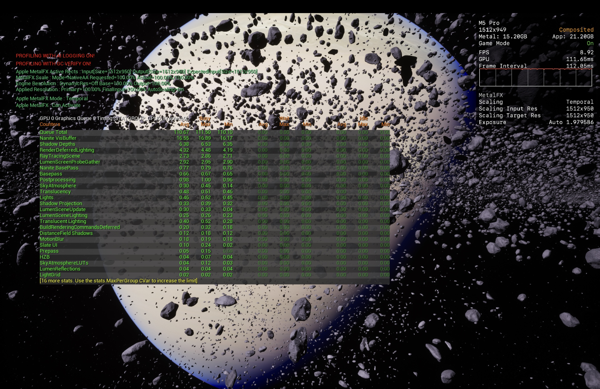
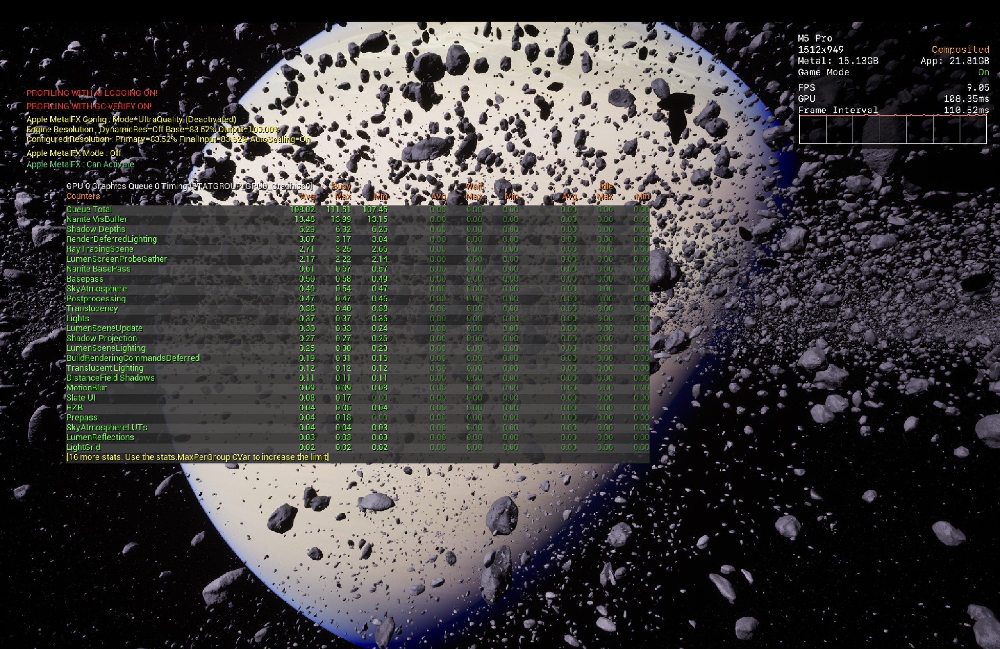

# macOS MetalFX Benchmark — 260725

[Benchmark index](../../../PerformanceValidation.md) · [한국어](Readme_KOR.md)

## Stress Test — Unreal Engine CassiniSample

| Device | CPU | GPU | Memory |
|:------:|:---:|:---:|:------:|
| MacBook Pro / Apple M5 Pro | 15 cores (5 Super + 10 Performance) | 16 cores | 24 GB |

**Profiling Conditions:** `AI Logging` and `GC Verify` enabled

### Captured Results — 260725

| Engine Base | Upscaler Mode | Input Resolution | Output Resolution | FPS | GPU | Queue Total Avg | Queue Total Range | MetalFX |
|:-----------:|:-------------:|:----------------:|:-----------------:|----:|----:|----------------:|:-----------------:|:-------:|
| **100.00%** | **Off** | 1512 × 950 | 1512 × 950 | **8.72** | **114.20 ms** | **113.72 ms** | 113.21–114.58 ms | ❌ Disabled |
| **100.00%** | **Temporal NativeAA** | 1512 × 950 | 1512 × 950 | **8.92** | **111.65 ms** | **110.67 ms** | 110.10–111.50 ms | ✅ Active |
| **83.52%** | **Off** | ≈1263 × 794 | 1512 × 950 | **9.05** | **108.35 ms** | **108.02 ms** | 107.45–111.51 ms | ❌ Disabled |
| **83.52%** | **Temporal UltraQuality** | 1263 × 794 | 1512 × 950 | **9.28** | **107.40 ms** | **106.65 ms** | 106.00–107.57 ms | ✅ Active |

### Paired Capture Comparison

| Engine Base | Comparison | FPS Difference | GPU Difference | Queue Total Avg Difference |
|:-----------:|:-----------|---------------:|---------------:|---------------------------:|
| **100.00%** | Temporal NativeAA vs. Off | **+0.20 (+2.29%)** | **-2.55 ms (-2.23%)** | **-3.05 ms (-2.68%)** |
| **83.52%** | Temporal UltraQuality vs. Off | **+0.23 (+2.54%)** | **-0.95 ms (-0.88%)** | **-1.37 ms (-1.27%)** |

### Stress-Test Profiling Evidence

#### 100% Engine Base

| MetalFX Off | MetalFX Temporal NativeAA |
|:---:|:---:|
|  |  |

#### 83.52% Engine Base

| MetalFX Off | MetalFX Temporal UltraQuality |
|:---:|:---:|
|  |  |
