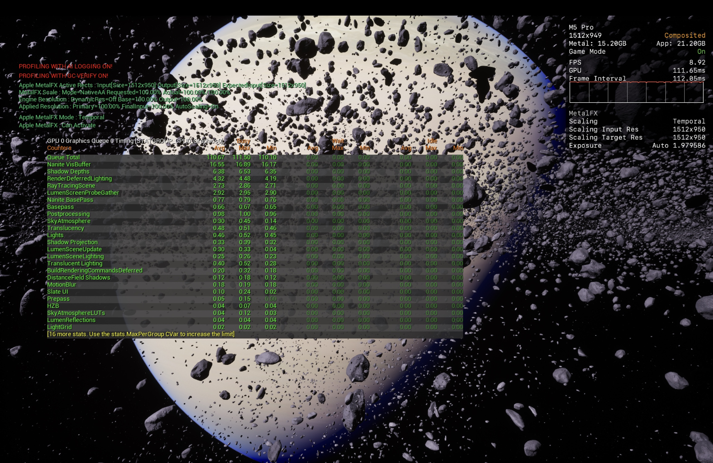
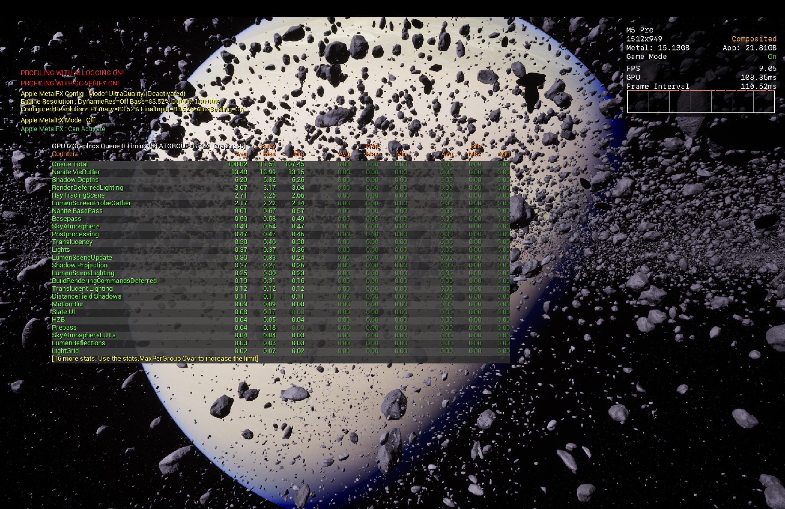

# macOS MetalFX 벤치마크 — 260725

[벤치마크 목록](../../../PerformanceValidation.md) · [English](Readme.md)

## 스트레스 테스트 — Unreal Engine CassiniSample

| 기기 | CPU | GPU | 메모리 |
|:------:|:---:|:---:|:------:|
| MacBook Pro / Apple M5 Pro | 15코어 (Super 5 + Performance 10) | 16코어 | 24 GB |

**프로파일링 조건:** `AI Logging` 및 `GC Verify` 활성화

### 캡처 결과 — 260725

| Engine Base | 업스케일러 모드 | 입력 해상도 | 출력 해상도 | FPS | GPU 시간 | Queue Total 평균 | Queue Total 범위 | MetalFX |
|:-----------:|:-------------:|:----------------:|:-----------------:|----:|----:|----------------:|:-----------------:|:-------:|
| **100.00%** | **Off** | 1512 × 950 | 1512 × 950 | **8.72** | **114.20 ms** | **113.72 ms** | 113.21–114.58 ms | ❌ 비활성화 |
| **100.00%** | **Temporal NativeAA** | 1512 × 950 | 1512 × 950 | **8.92** | **111.65 ms** | **110.67 ms** | 110.10–111.50 ms | ✅ 활성화 |
| **83.52%** | **Off** | ≈1263 × 794 | 1512 × 950 | **9.05** | **108.35 ms** | **108.02 ms** | 107.45–111.51 ms | ❌ 비활성화 |
| **83.52%** | **Temporal UltraQuality** | 1263 × 794 | 1512 × 950 | **9.28** | **107.40 ms** | **106.65 ms** | 106.00–107.57 ms | ✅ 활성화 |

### 캡처 조건별 비교

| Engine Base | 비교 | FPS 차이 | GPU 시간 차이 | Queue Total 평균 차이 |
|:-----------:|:-----------|---------------:|---------------:|---------------------------:|
| **100.00%** | Temporal NativeAA와 Off 비교 | **+0.20 (+2.29%)** | **-2.55 ms (-2.23%)** | **-3.05 ms (-2.68%)** |
| **83.52%** | Temporal UltraQuality와 Off 비교 | **+0.23 (+2.54%)** | **-0.95 ms (-0.88%)** | **-1.37 ms (-1.27%)** |

### 스트레스 테스트 프로파일링 증거 자료

#### Engine Base 100%

| MetalFX Off | MetalFX Temporal NativeAA |
|:---:|:---:|
|  |  |

#### Engine Base 83.52%

| MetalFX Off | MetalFX Temporal UltraQuality |
|:---:|:---:|
|  |  |
