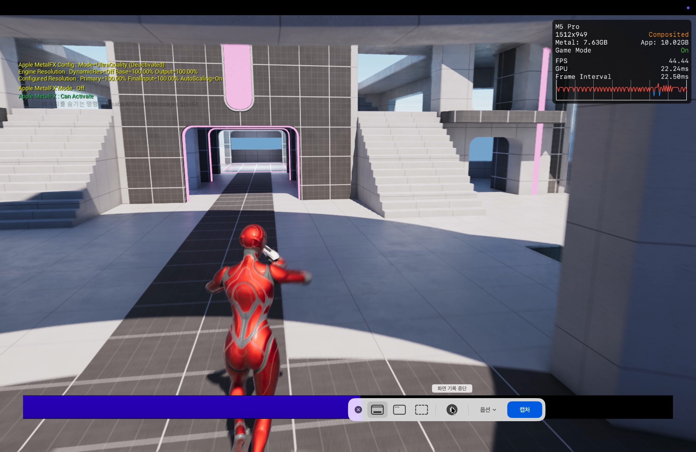
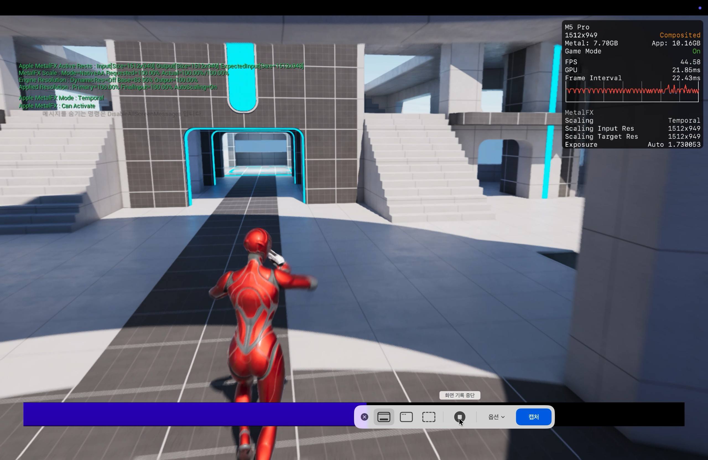
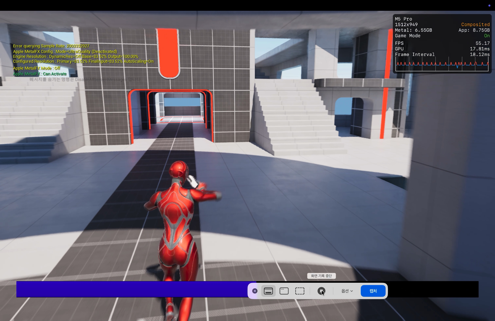
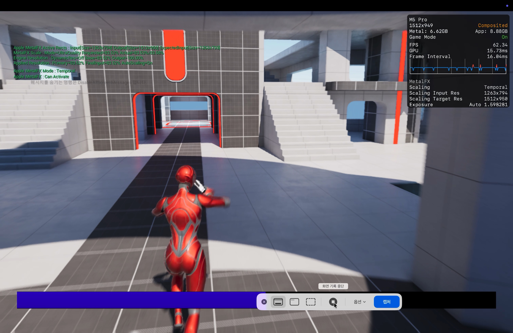
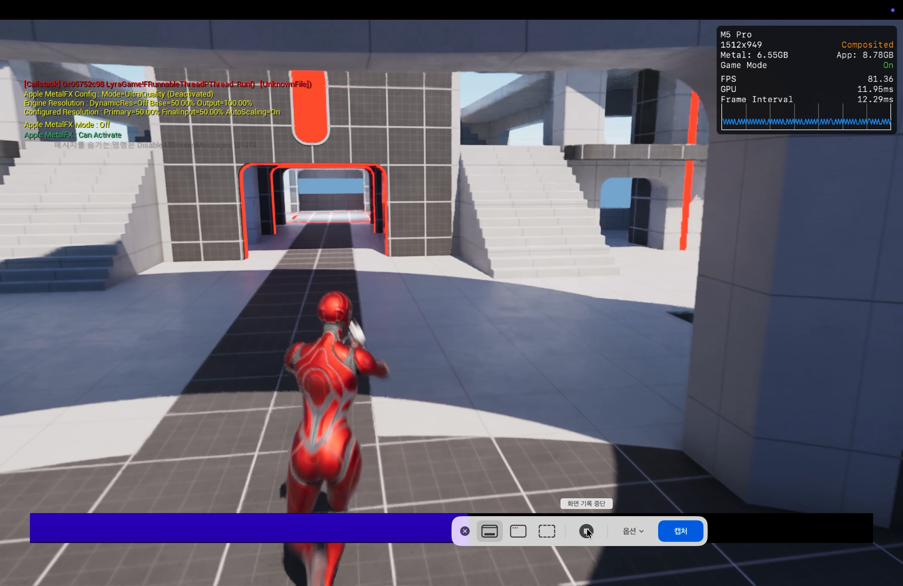
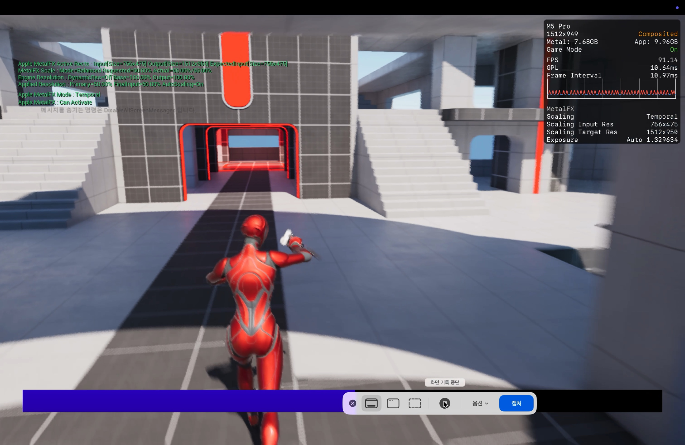

# macOS MetalFX Benchmark — 260726

[Benchmark index](../../../PerformanceValidation.md) · [한국어](Readme_KOR.md)

## Main Benchmark — Unreal Engine Lyra Sample

| Device | CPU | GPU | Memory |
|:------:|:---:|:---:|:------:|
| MacBook Pro / Apple M5 Pro | 15 cores (5 Super + 10 Performance) | 16 cores | 24 GB |

### Full-Sequence Average — 260726

| Input Scale | Upscaler Mode | Input → Output Resolution | FPS Avg | FPS Range | GPU Avg | GPU Range | Frame Interval Avg |
|:-----------:|:-------------:|:-------------------------:|--------:|:---------:|--------:|:---------:|-------------------:|
| **100.00%** | **Off** | 1512 × 949 → 1512 × 949 | **45.010** | 43.77–47.92 | **21.887 ms** | 20.45–22.51 ms | **22.228 ms** |
| **100.00%** | **Temporal NativeAA** | 1512 × 949 → 1512 × 949 | **45.055** | 43.90–46.15 | **21.537 ms** | 21.00–22.08 ms | **22.200 ms** |
| **83.52%** | **Off** | ≈1263 × 794 → 1512 × 949 | **55.540** | 54.34–58.78 | **17.644 ms** | 16.65–18.00 ms | **18.009 ms** |
| **83.52%** | **Temporal UltraQuality** | 1263 × 794 → 1512 × 950 | **62.248** | 60.50–65.16 | **15.684 ms** | 14.92–16.15 ms | **16.068 ms** |
| **50.00%** | **Off** | ≈756 × 475 → 1512 × 949 | **80.755** | 79.12–82.29 | **12.045 ms** | 11.79–12.34 ms | **12.384 ms** |
| **50.00%** | **Temporal Balanced** | 756 × 475 → 1512 × 950 | **90.179** | 86.75–92.31 | **10.702 ms** | 10.45–11.09 ms | **11.092 ms** |

### Full-Sequence Paired Comparison

| Input Scale | Comparison | FPS Difference | GPU Difference | Frame Interval Difference |
|:-----------:|:-----------|---------------:|---------------:|--------------------------:|
| **100.00%** | Temporal NativeAA vs. Off | **+0.045 (+0.10%)** | **-0.350 ms (-1.60%)** | **-0.028 ms (-0.13%)** |
| **83.52%** | Temporal UltraQuality vs. Off | **+6.708 (+12.08%)** | **-1.960 ms (-11.11%)** | **-1.941 ms (-10.78%)** |
| **50.00%** | Temporal Balanced vs. Off | **+9.424 (+11.67%)** | **-1.343 ms (-11.15%)** | **-1.292 ms (-10.43%)** |

### Specific Scene — Grenade Throw

| Input Scale | Upscaler Mode | FPS | GPU | Frame Interval |
|:-----------:|:-------------:|----:|----:|---------------:|
| **100.00%** | **Off** | **44.44** | **22.24 ms** | **22.50 ms** |
| **100.00%** | **Temporal NativeAA** | **44.58** | **21.85 ms** | **22.43 ms** |
| **83.52%** | **Off** | **55.17** | **17.81 ms** | **18.12 ms** |
| **83.52%** | **Temporal UltraQuality** | **62.34** | **15.73 ms** | **16.04 ms** |
| **50.00%** | **Off** | **81.36** | **11.95 ms** | **12.29 ms** |
| **50.00%** | **Temporal Balanced** | **91.14** | **10.64 ms** | **10.97 ms** |

### Grenade-Throw Paired Comparison

| Input Scale | Comparison | FPS Difference | GPU Difference | Frame Interval Difference |
|:-----------:|:-----------|---------------:|---------------:|--------------------------:|
| **100.00%** | Temporal NativeAA vs. Off | **+0.14 (+0.32%)** | **-0.39 ms (-1.75%)** | **-0.07 ms (-0.31%)** |
| **83.52%** | Temporal UltraQuality vs. Off | **+7.17 (+13.00%)** | **-2.08 ms (-11.68%)** | **-2.08 ms (-11.48%)** |
| **50.00%** | Temporal Balanced vs. Off | **+9.78 (+12.02%)** | **-1.31 ms (-10.96%)** | **-1.32 ms (-10.74%)** |

### Grenade-Throw Evidence

Replay playback may display some scene colors differently due to a replay-system bug. These color differences are not treated as upscaler quality differences.

#### 100% Input Scale

| MetalFX Off | MetalFX Temporal NativeAA |
|:---:|:---:|
|  |  |

#### 83.52% Input Scale

| MetalFX Off | MetalFX Temporal UltraQuality |
|:---:|:---:|
|  |  |

#### 50% Input Scale

| MetalFX Off | MetalFX Temporal Balanced |
|:---:|:---:|
|  |  |

Full-resolution aligned frames, comparison sheets, source checksums, and
alignment metadata are retained in the
[260726 benchmark evidence package](#metalfx-50-balanced-benchmark-evidence--260726).

## MetalFX 50% Balanced Benchmark Evidence — 260726

This package retains the compact, shareable evidence needed to explain the
50% MetalFX Temporal Balanced comparison without keeping the complete screen
recordings in the repository.

### Retained Assets

| File | Description |
|:-----|:------------|
| [50percent_temporal_balanced_aligned_t7.png](../../../ProfilingResults/50percent_temporal_balanced_aligned_t7.png) | Full-resolution frame extracted from the 50% Temporal Balanced recording |
| [50percent_off_aligned_t7.png](../../../ProfilingResults/50percent_off_aligned_t7.png) | Full-resolution frame extracted from the final 50% MetalFX Off recording |
| [100percent_off_reference_aligned_t7.png](../../../ProfilingResults/100percent_off_reference_aligned_t7.png) | Full-resolution frame extracted from the 100% MetalFX Off reference recording |
| [50percent_aligned_keyframe_comparison.jpg](../../../ProfilingResults/50percent_aligned_keyframe_comparison.jpg) | Three-column, full-size aligned comparison |
| [50percent_aligned_sequence_comparison_large.jpg](../../../ProfilingResults/50percent_aligned_sequence_comparison_large.jpg) | Five-timepoint overview at 0, 2, 4, 6, and 8 seconds |

Each retained PNG frame is 3024 × 1964. The three-column keyframe comparison
uses the source frames without spatial downscaling and is saved as a
high-quality JPEG.

### Source Mapping

| Mode | Temporary source | Size | SHA-256 |
|:-----|:-----------------|-----:|:--------|
| 50% Temporal Balanced | `video_70231.mov` | 169,715,856 bytes | `6d87d2b89fa8f01eb433ecbeae83074bdd88aa133170c81f5ff4f9716a035eb6` |
| 50% MetalFX Off | `video_70531.mov` | 146,390,602 bytes | `74a4d159eae7df70e8f778fba1567b13678b458620bde7c38a2da01da9b15e45` |
| 100% MetalFX Off reference | `reference_100off.mov` | 75,718,153 bytes | `5795b538b415bda245940c49610d4baad9fc430a31eb968891c04dc3f6509bd6` |

The original screen recordings remain temporary working data and are not part
of this evidence package.

### Alignment

Edge-pattern matching over frames sampled every 0.2 seconds produced these
offsets relative to the 100% Off reference:

- 50% Temporal Balanced: +11.2 seconds
- 50% MetalFX Off: +8.2 seconds

The retained keyframe corresponds to reference time 7.0 seconds:

| Mode | Requested source time | Actual decoded time |
|:-----|----------------------:|--------------------:|
| 50% Temporal Balanced | 18.200 s | 18.192 s |
| 50% MetalFX Off | 15.200 s | 15.200 s |
| 100% MetalFX Off reference | 7.000 s | 6.983 s |

### Interpretation Limits

- The replay system can change scene colors between runs. Color differences
  are not treated as upscaler-quality differences.
- The recordings contain benchmark HUD and macOS screen-capture controls.
- The aligned runs are close but are not deterministic pixel-identical
  renders.
- These assets support qualitative inspection of edge reconstruction,
  silhouette stability, and visible large-scale artifacts. They are not valid
  ground truth for PSNR or SSIM measurement.
