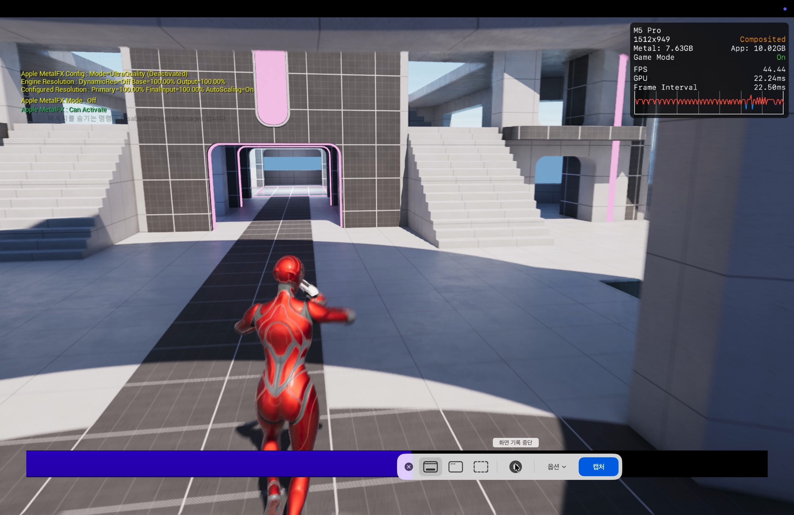
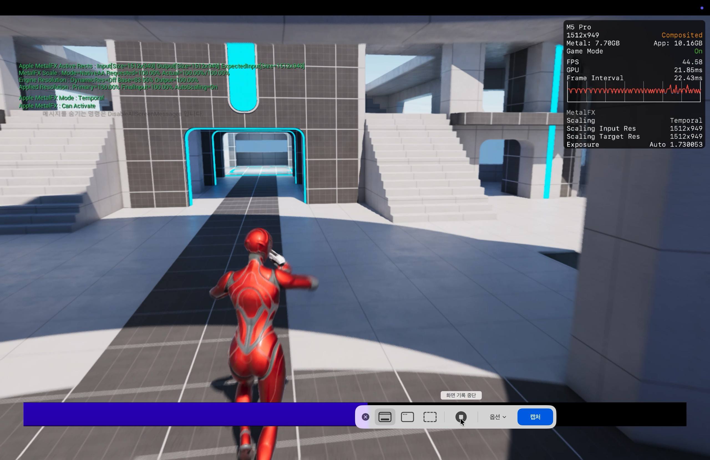
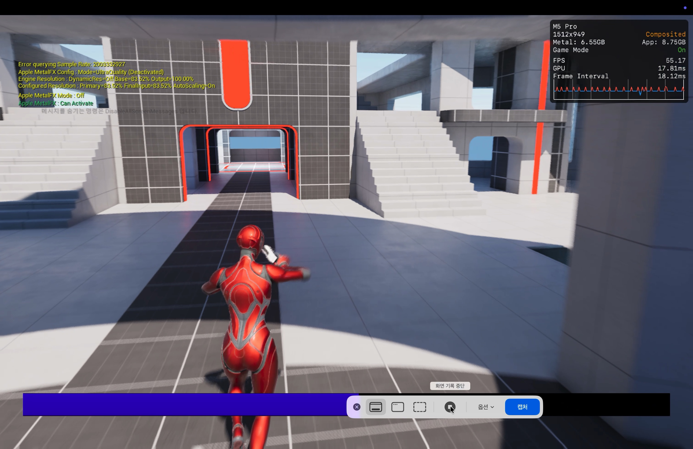
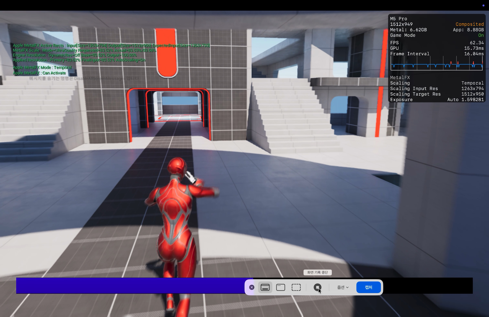
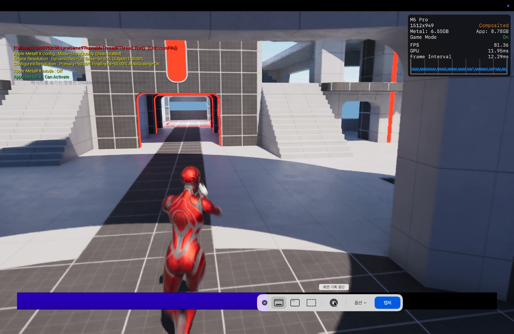
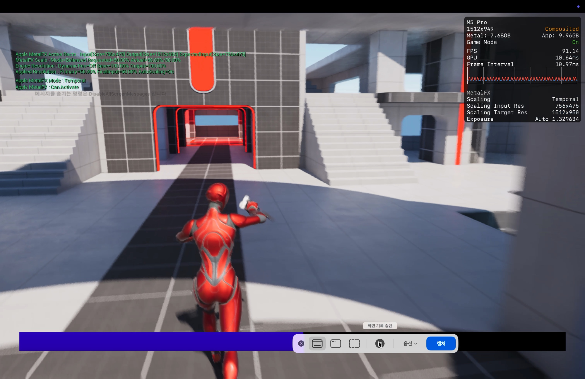

# macOS MetalFX 벤치마크 — 260726

[벤치마크 목록](../../../PerformanceValidation.md) · [English](Readme.md)

## 주요 벤치마크 — Unreal Engine Lyra Sample

| 기기 | CPU | GPU | 메모리 |
|:------:|:---:|:---:|:------:|
| MacBook Pro / Apple M5 Pro | 15코어 (Super 5 + Performance 10) | 16코어 | 24 GB |

### 전체 시퀀스 평균 — 260726

| 입력 배율 | 업스케일러 모드 | 입력 → 출력 해상도 | 평균 FPS | FPS 범위 | 평균 GPU 시간 | GPU 시간 범위 | 평균 프레임 간격 |
|:-----------:|:-------------:|:-------------------------:|--------:|:---------:|--------:|:---------:|-------------------:|
| **100.00%** | **Off** | 1512 × 949 → 1512 × 949 | **45.010** | 43.77–47.92 | **21.887 ms** | 20.45–22.51 ms | **22.228 ms** |
| **100.00%** | **Temporal NativeAA** | 1512 × 949 → 1512 × 949 | **45.055** | 43.90–46.15 | **21.537 ms** | 21.00–22.08 ms | **22.200 ms** |
| **83.52%** | **Off** | ≈1263 × 794 → 1512 × 949 | **55.540** | 54.34–58.78 | **17.644 ms** | 16.65–18.00 ms | **18.009 ms** |
| **83.52%** | **Temporal UltraQuality** | 1263 × 794 → 1512 × 950 | **62.248** | 60.50–65.16 | **15.684 ms** | 14.92–16.15 ms | **16.068 ms** |
| **50.00%** | **Off** | ≈756 × 475 → 1512 × 949 | **80.755** | 79.12–82.29 | **12.045 ms** | 11.79–12.34 ms | **12.384 ms** |
| **50.00%** | **Temporal Balanced** | 756 × 475 → 1512 × 950 | **90.179** | 86.75–92.31 | **10.702 ms** | 10.45–11.09 ms | **11.092 ms** |

### 전체 시퀀스 조건별 비교

| 입력 배율 | 비교 | FPS 차이 | GPU 시간 차이 | 프레임 간격 차이 |
|:-----------:|:-----------|---------------:|---------------:|--------------------------:|
| **100.00%** | Temporal NativeAA와 Off 비교 | **+0.045 (+0.10%)** | **-0.350 ms (-1.60%)** | **-0.028 ms (-0.13%)** |
| **83.52%** | Temporal UltraQuality와 Off 비교 | **+6.708 (+12.08%)** | **-1.960 ms (-11.11%)** | **-1.941 ms (-10.78%)** |
| **50.00%** | Temporal Balanced와 Off 비교 | **+9.424 (+11.67%)** | **-1.343 ms (-11.15%)** | **-1.292 ms (-10.43%)** |

### 특정 장면 — 수류탄 투척

| 입력 배율 | 업스케일러 모드 | FPS | GPU 시간 | 프레임 간격 |
|:-----------:|:-------------:|----:|----:|---------------:|
| **100.00%** | **Off** | **44.44** | **22.24 ms** | **22.50 ms** |
| **100.00%** | **Temporal NativeAA** | **44.58** | **21.85 ms** | **22.43 ms** |
| **83.52%** | **Off** | **55.17** | **17.81 ms** | **18.12 ms** |
| **83.52%** | **Temporal UltraQuality** | **62.34** | **15.73 ms** | **16.04 ms** |
| **50.00%** | **Off** | **81.36** | **11.95 ms** | **12.29 ms** |
| **50.00%** | **Temporal Balanced** | **91.14** | **10.64 ms** | **10.97 ms** |

### 수류탄 투척 장면 조건별 비교

| 입력 배율 | 비교 | FPS 차이 | GPU 시간 차이 | 프레임 간격 차이 |
|:-----------:|:-----------|---------------:|---------------:|--------------------------:|
| **100.00%** | Temporal NativeAA와 Off 비교 | **+0.14 (+0.32%)** | **-0.39 ms (-1.75%)** | **-0.07 ms (-0.31%)** |
| **83.52%** | Temporal UltraQuality와 Off 비교 | **+7.17 (+13.00%)** | **-2.08 ms (-11.68%)** | **-2.08 ms (-11.48%)** |
| **50.00%** | Temporal Balanced와 Off 비교 | **+9.78 (+12.02%)** | **-1.31 ms (-10.96%)** | **-1.32 ms (-10.74%)** |

### 수류탄 투척 장면 증거 자료

리플레이 시스템 버그로 인해 재생 시 일부 장면의 색상이 다르게 표시될 수 있습니다. 이러한 색상 차이는 업스케일러의 화질 차이로 판단하지 않습니다.

#### 입력 배율 100%

| MetalFX Off | MetalFX Temporal NativeAA |
|:---:|:---:|
|  |  |

#### 입력 배율 83.52%

| MetalFX Off | MetalFX Temporal UltraQuality |
|:---:|:---:|
|  |  |

#### 입력 배율 50%

| MetalFX Off | MetalFX Temporal Balanced |
|:---:|:---:|
|  |  |

원본 해상도의 정렬된 프레임, 비교 이미지, 원본 체크섬 및
정렬 메타데이터는
[260726 벤치마크 증거 자료](Readme.md#metalfx-50-balanced-benchmark-evidence--260726)에 보존되어 있습니다.

