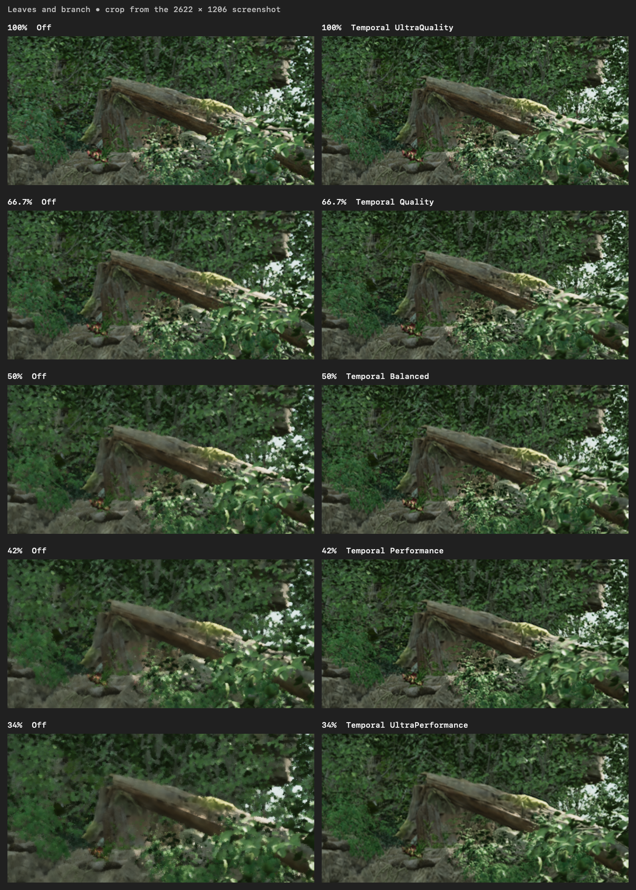
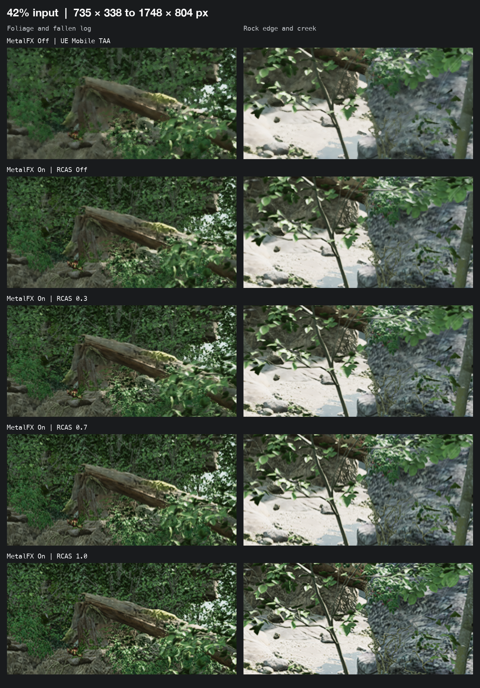

# MetalFX benchmark — iPhone 17 (A19)

[Benchmark index](../../../PerformanceValidation.md) · [한국어](Readme_KOR.md)

| Device | OS | App | Engine | Scene |
|---|---|---|---|---|
| iPhone 17 (A19) | iOS 27.2.1 | ElectricDreamsEnv 1.0 (0.0.28) | Unreal Engine 5.7.4 Development | Mobile Forest, default spawn |

## Performance benchmark

MetalFX Temporal (On) and Unreal Mobile TAA (Off) used matching input sizes and a fixed 1748 × 804 output. Dynamic resolution, Engine Base scaling and the frame rate cap were disabled. Thermal conditions were kept as consistent as possible.

We captured three rounds, measuring the MetalFX quality presets and their corresponding Off conditions in each round.

Each run used about 12 seconds of Unreal CSV profiler data with 0.5 seconds trimmed from each end. FPS is retained frames divided by retained frame time in seconds. Timing values are means of valid `GPUTime` and `FrameTime` samples. The table shows the mean [min, max] across three runs.

| Input scale | Input (px) | Upscaler | FPS | GPU time (ms) | Frame time (ms) |
|---:|---:|---|---:|---:|---:|
| 100% | 1748 × 804 | Off · UE Mobile TAA | 21.183 [20.170, 21.704] | 47.137 [45.936, 49.454] | 47.264 [46.075, 49.579] |
| 100% | 1748 × 804 | On · UltraQuality | 19.654 [18.785, 20.911] | 50.899 [47.749, 53.118] | 50.988 [47.822, 53.233] |
| 66.7% | 1166 × 537 | Off · UE Mobile TAA | 25.152 [24.934, 25.387] | 39.665 [39.322, 39.996] | 39.761 [39.390, 40.105] |
| 66.7% | 1166 × 537 | On · Quality | 23.092 [22.279, 24.621] | 43.298 [40.543, 44.842] | 43.397 [40.616, 44.884] |
| 50% | 874 × 402 | Off · UE Mobile TAA | 26.881 [26.634, 27.347] | 37.143 [36.537, 37.526] | 37.206 [36.567, 37.546] |
| 50% | 874 × 402 | On · Balanced | 24.985 [21.418, 26.961] | 40.409 [37.033, 46.633] | 40.469 [37.091, 46.691] |
| 42% | 735 × 338 | Off · UE Mobile TAA | 28.015 [27.443, 28.909] | 35.766 [34.736, 36.395] | 35.714 [34.591, 36.439] |
| 42% | 735 × 338 | On · Performance | 27.787 [27.488, 28.266] | 35.940 [35.355, 36.300] | 35.993 [35.378, 36.379] |
| 34% | 595 × 274 | Off · UE Mobile TAA | 28.118 [25.323, 29.995] | 35.696 [33.160, 39.375] | 35.756 [33.339, 39.490] |
| 34% | 595 × 274 | On · UltraPerformance | 27.664 [25.438, 29.212] | 36.272 [34.310, 39.236] | 36.276 [34.233, 39.312] |

### Paired On − Off differences

Each row averages the three paired On − Off differences and their percentage differences relative to Off. [Per-run measurements](runs.csv)

| Input scale | FPS difference | GPU time difference (ms) | Frame time difference (ms) |
|---:|---:|---:|---:|
| 100% | -1.529 (-7.15%) | +3.762 (+8.06%) | +3.724 (+7.96%) |
| 66.7% | -2.059 (-8.16%) | +3.632 (+9.19%) | +3.636 (+9.18%) |
| 50% | -1.896 (-7.11%) | +3.266 (+8.72%) | +3.263 (+8.70%) |
| 42% | -0.228 (-0.79%) | +0.174 (+0.51%) | +0.279 (+0.81%) |
| 34% | -0.454 (-1.52%) | +0.576 (+1.73%) | +0.520 (+1.56%) |

### On/Off still-image comparison

Round 3 screenshots use matching camera positions and 660 × 320 px crops at the original screenshot scale. Foliage positions vary between captures.

[Foliage and fallen log](../../../ProfilingResults/on-off-foliage.png) · [Rock edge and creek](../../../ProfilingResults/on-off-rocks.png)

## RCAS sharpening capture test

This still-image test was run separately after the performance benchmark. Each input scale has five captures from the same camera position with matched render sizes. The conditions are Off, MetalFX On (RCAS 0.0), and MetalFX On with RCAS 0.3, 0.7 or 1.0. GPU passes confirmed the three nonzero strengths.

| Input scale | Preset | Five-condition comparison |
|---:|---|---|
| 50% | Balanced | [50% captures](../../../ProfilingResults/rcas-50.png) |
| 42% | Performance | [42% captures](../../../ProfilingResults/rcas-42.png) |
| 34% | UltraPerformance | [34% captures](../../../ProfilingResults/rcas-34.png) |

