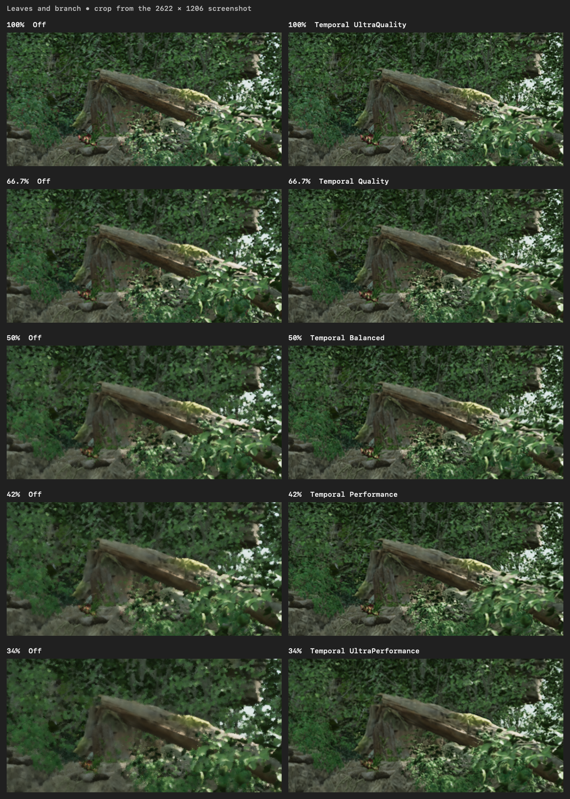
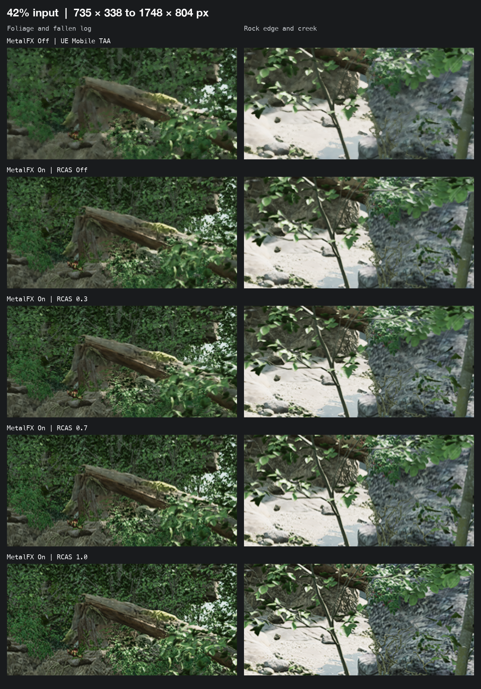

# MetalFX 벤치마크 · iPhone 17 (A19)

[벤치마크 목록](../../../PerformanceValidation.md) · [English](Readme.md)

| 기기 | OS | 앱 | 엔진 | 장면 |
|---|---|---|---|---|
| iPhone 17 (A19) | iOS 27.2.1 | ElectricDreamsEnv 1.0 (0.0.28) | Unreal Engine 5.7.4 Development | Mobile Forest 기본 스폰 |

## 성능 벤치마크

MetalFX Temporal(On)과 Unreal Mobile TAA(Off)는 각 배율에서 같은 입력 해상도를 사용했습니다. 출력은 1748 × 804로 고정했습니다. 동적 해상도, Engine Base 배율 연동, 프레임 제한을 해제했습니다. 온도는 최대한 동일한 조건에서 진행했습니다.

총 3회 캡쳐 진행하였고, 각 회차별 MetalFX Quality 프리셋과, 이에 대응하는 Off 조건을 측정했습니다.

조건마다 약 12초를 Unreal CSV 프로파일러로 기록하고 처음과 끝의 0.5초에 걸친 프레임을 제외했습니다. FPS는 남은 프레임 수를 총 프레임 시간(초)으로 나눈 값입니다. GPU 시간과 프레임타임은 유효한 `GPUTime`과 `FrameTime`의 평균입니다. 표는 3회 측정의 평균 [최솟값, 최댓값]입니다.

| 입력 배율 | 입력 해상도 (px) | 업스케일러 | FPS | GPU 시간 (ms) | 프레임타임 (ms) |
|---:|---:|---|---:|---:|---:|
| 100% | 1748 × 804 | Off · UE Mobile TAA | 21.183 [20.170, 21.704] | 47.137 [45.936, 49.454] | 47.264 [46.075, 49.579] |
| 100% | 1748 × 804 | On · UltraQuality | 19.654 [18.785, 20.911] | 50.899 [47.749, 53.118] | 50.988 [47.822, 53.233] |
| 66.7% | 1166 × 537 | Off · UE Mobile TAA | 25.152 [24.934, 25.387] | 39.665 [39.322, 39.996] | 39.761 [39.390, 40.105] |
| 66.7% | 1166 × 537 | On · Quality | 23.092 [22.279, 24.621] | 43.298 [40.543, 44.842] | 43.397 [40.616, 44.884] |
| 50% | 874 × 402 | Off · UE Mobile TAA | 26.881 [26.634, 27.347] | 37.143 [36.537, 37.526] | 37.206 [36.567, 37.546] |
| 50% | 874 × 402 | On · Balanced | 24.985 [21.418, 26.961] | 40.409 [37.033, 46.633] | 40.469 [37.091, 46.691] |
| 42% | 735 × 338 | Off · UE Mobile TAA | 28.015 [27.443, 28.909] | 35.766 [34.736, 36.395] | 35.714 [34.591, 36.439] |
| 42% | 735 × 338 | On · Performance | 27.787 [27.488, 28.266] | 35.940 [35.355, 36.300] | 35.993 [35.378, 36.379] |
| 34% | 595 × 274 | Off · UE Mobile TAA | 28.118 [25.323, 29.995] | 35.696 [33.160, 39.375] | 35.756 [33.339, 39.490] |
| 34% | 595 × 274 | On · UltraPerformance | 27.664 [25.438, 29.212] | 36.272 [34.310, 39.236] | 36.276 [34.233, 39.312] |

### 같은 회차의 On − Off 차이

각 회차에서 On − Off의 차이와 Off 대비 변화율을 구한 뒤 3회 평균을 냈습니다. [회차별 측정값](runs.csv)

| 입력 배율 | FPS 차이 | GPU 시간 차이 (ms) | 프레임타임 차이 (ms) |
|---:|---:|---:|---:|
| 100% | -1.529 (-7.15%) | +3.762 (+8.06%) | +3.724 (+7.96%) |
| 66.7% | -2.059 (-8.16%) | +3.632 (+9.19%) | +3.636 (+9.18%) |
| 50% | -1.896 (-7.11%) | +3.266 (+8.72%) | +3.263 (+8.70%) |
| 42% | -0.228 (-0.79%) | +0.174 (+0.51%) | +0.279 (+0.81%) |
| 34% | -0.454 (-1.52%) | +0.576 (+1.73%) | +0.520 (+1.56%) |

### On/Off 정지 화면 비교

같은 기본 시점에서 찍은 3회차 화면에서 660 × 320 픽셀 영역을 원본 크기 그대로 잘랐습니다. 잎의 위치는 캡처 시점에 따라 달라집니다.

[식생과 통나무](../../../ProfilingResults/on-off-foliage.png) · [바위와 물가](../../../ProfilingResults/on-off-rocks.png)

## RCAS 샤프닝 캡처 테스트

성능 벤치마크 이후 별도로 진행한 정지 화면 테스트입니다. 배율마다 같은 카메라 시점과 렌더 해상도에서 Off, MetalFX On(RCAS 0.0), MetalFX On + RCAS 0.3·0.7·1.0을 각각 캡처했습니다. GPU 패스에서 0.3·0.7·1.0 적용을 확인했습니다.

| 입력 배율 | 프리셋 | 5조건 비교 이미지 |
|---:|---|---|
| 50% | Balanced | [50% 캡처](../../../ProfilingResults/rcas-50.png) |
| 42% | Performance | [42% 캡처](../../../ProfilingResults/rcas-42.png) |
| 34% | UltraPerformance | [34% 캡처](../../../ProfilingResults/rcas-34.png) |

